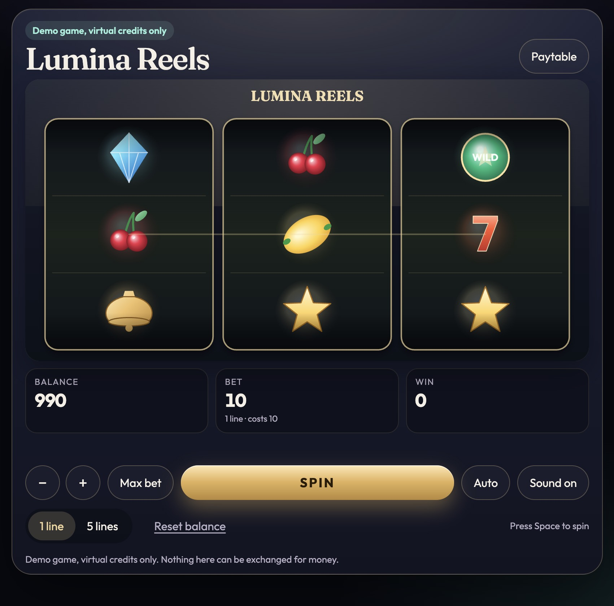

# Lumina Reels

A small slot machine for a portfolio, drawn on an HTML canvas. It uses virtual credits only. Nothing in the game can be cashed out or exchanged for money.

**Demo game, virtual credits only.**



A short gameplay recording can be dropped in later at `docs/gameplay.gif`.

## Stack

- TypeScript and Vite. The game loop is vanilla TypeScript, with no game framework and no React wrapper.
- HTML5 Canvas 2D for the reels, symbols, and win effects.
- Vitest for the rules, the seeded RNG, and the reel landing.
- ESLint and Prettier.

Symbols are canvas shapes and gradients. There is no third-party art, and no branded casino graphics.

## Run

```bash
npm install
npm run dev
```

The dev server uses the GitHub Pages base path, so open `http://127.0.0.1:5173/canvas-slot-machine/`.

```bash
npm test          # unit tests
npm run lint      # ESLint and Prettier
npm run build     # typecheck and production bundle
npm run simulate  # 1,000,000 spins, prints RTP
```

Add `?seed=10` to replay the same spin sequence. Reel strips themselves always come from one fixed layout seed, so the published RTP matches every session.

## How to play

Three reels, three visible rows. The stake is per line.

- **1 line** plays the middle row.
- **5 lines** adds the top row, the bottom row, and both diagonals. The spin costs bet × lines.
- Bets are 10, 20, 50, and 100 credits. **Max bet** selects 100.
- A new game starts at 1,000 credits. The balance is stored in `localStorage`. **Reset balance** puts it back to 1,000.
- **Spin** or the Space key starts a round. Controls are locked until the reels and the win count finish, so a round cannot be started twice.
- **Auto** plays 10 spins. It turns into **Stop**, which cancels the spins still queued. The spin already on screen finishes.
- **Sound** toggles tones generated in the browser. There are no audio files.
- If the stake does not fit, the game stays idle and shows **Not enough credits**. The balance never goes negative.

### Paytable

The multiplier applies to the line bet. Wild substitutes for any other symbol. Three wilds pay as Wild. Two cherries pay a small prize, including cherry + wild + some other symbol. A wild that completes three of a kind pays the triple instead of the pair.

| Symbol  | Combination | Pays |
| ------- | ----------- | ---: |
| Cherry  | ×3          |   4× |
| Cherry  | ×2          |   1× |
| Lemon   | ×3          |   8× |
| Bell    | ×3          |  15× |
| Star    | ×3          |  25× |
| Seven   | ×3          |  50× |
| Diamond | ×3          |  80× |
| Wild    | ×3          | 200× |

Each reel is a strip of 100 stops. The counts are Cherry 25, Lemon 22, Bell 18, Star 14, Seven 10, Diamond 7, Wild 4.

## Architecture

The outcome is decided before anything moves. The animator only eases each reel onto the stop it was given.

```
index.html
└── src/main.ts                 creates SlotGame and starts the frame loop
    └── src/game.ts             input, rAF + delta time, balance tween
        ├── engine/rng.ts       seeded Mulberry32
        ├── engine/reels.ts     weighted strips and the visible window
        ├── engine/evaluate.ts  pure payline scoring
        ├── engine/state.ts     idle → spinning → stopping → evaluating → winAnimation → idle
        ├── engine/spin.ts      draws the round before the animation
        ├── engine/rtp.ts       exact single-line return
        ├── render/reelMotion.ts    accelerate, blur, ease, bounce
        ├── render/symbols.ts       canvas symbols
        ├── render/stage.ts         cabinet, paylines, win glow
        ├── audio/sfx.ts            Web Audio tones
        └── storage.ts              balance and mute
```

`npm run simulate` imports the engine only. It does not boot the canvas.

## RNG and RTP

`createRng(seed)` is Mulberry32. The same seed replays the same sequence, which is what the unit tests and `?seed=` use. Stops are `floor(next() * stripLength)`.

The reel layout is shuffled once from seed `20261026`. A spin then picks a stop on each strip. Because a strip holds each symbol exactly as often as its weight, the middle row (and every other row, taken on its own) has that distribution. The three reels are independent, so every payline has the same expected return. Five lines multiply the stake and the expected win by five, so the RTP does not change. Neighboring rows are correlated, which changes the variance, not the mean. Enumerating all 1,000,000 stop combinations on the shipped strips confirms the five-line RTP matches the formula.

**Theoretical RTP: 96.42% per payline. About 23.79% of lines pay something.**

`npm run simulate` runs 1,000,000 spins from seed 1 (line bet 1):

| Mode    | Total bet | Total won | Simulated RTP | Hit rate |
| ------- | --------: | --------: | ------------: | -------: |
| 1 line  | 1,000,000 |   963,563 |        96.36% |   23.81% |
| 5 lines | 5,000,000 | 4,861,279 |        97.23% |   66.09% |

The 1-line run sits on the theoretical 96.42%. The 5-line run is the same expectation with more variance, because a single diamond or wild triple moves a million-spin sample. The exact strip enumeration, not the sample, is the figure to quote.

## Deploy

`vite.config.ts` sets `base` to `/canvas-slot-machine/`. Change that if the repository name differs.

`.github/workflows/pages.yml` lints, tests, builds, and deploys `dist` to GitHub Pages on pushes to `main`. In the repository settings, set Pages to **GitHub Actions**.

## Future improvements

- More paylines, or a player-chosen subset instead of only 1 and 5.
- A bonus round, for example a held-wild respin after three diamonds.
- A fuller sound set: per-symbol stops, a reel tick, and a distinct sting for the top prize.
